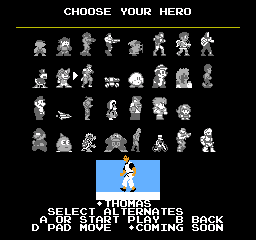
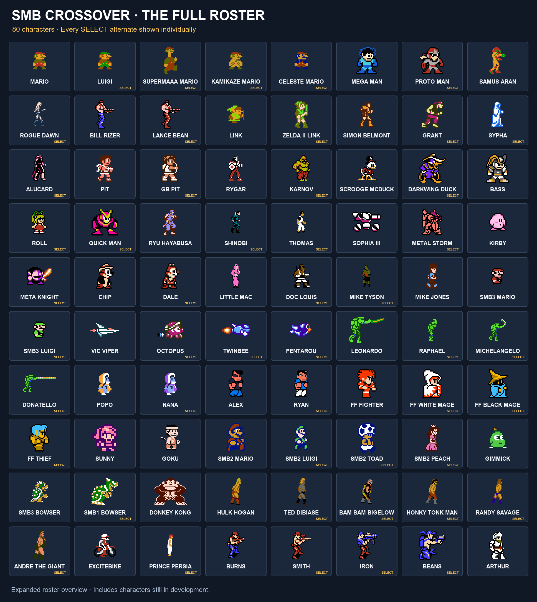

# SMB Crossover for NES

**One Mushroom Kingdom. A whole NES library of heroes.**

A native NES adaptation of [Super Mario Bros. Crossover](https://www.smbgames.be/smb-crossover.php), built on [SMB1Base](https://github.com/smbstudio/smb1base). Play SMB's levels with character-specific movement, weapons, upgrades, music and health systems.

[Player's guide](<Player Guide/SMB-Crossover-Players-Guide-NU.pdf>) · [Full roster image](docs/images/SMB-Crossover-Full-Roster.png) · [Build from source](#build-from-source) · [Report a bug](https://github.com/kandowontu2/SMB-Crossover/issues)

> **In development:** the November 3 expanded MMC5 nightly has **93 selectable identities** across a **32-slot, four-row menu**. Prince of Persia is displayed but remains locked; additional requested characters are still being integrated. Menu availability does not mean every character has completed stage and powerup testing. The prepared source build currently contains 37 identities; see the build table below.

<p align="center">
  
</p>

*Actual emulator capture from the November 1 85-character WIP.*

## What's in the game?

- **Distinct characters.** Busters, swords, arrows, Morph Ball bombs, pogo attacks, copy abilities, a Diskarmor and more.
- **Character-specific progression.** Health, ammo, EXP, spells, weapon inventories and upgrades vary by character.
- **Easy and Hard modes.** Easy enables ordinary stomping for ground characters; Hard uses character-specific contact rules and the migrated Crossover 2.02 equipment systems.
- **More than a reskin.** Zelda II Link has an upgrade/spell menu, SMB3 Mario has multiple forms and a P meter, and the Gradius/Parodius ships have graphical powerup bars.
- **Options for testing and play.** Player outlines, level selection, invincibility, mid-air jumps, screen wrapping, a frozen timer and full power.
- **An audio browser.** Test character-labelled music and sound effects in the expanded MMC5 build.

The title opens a separate character-select screen. Use the D-pad to highlight a slot and **Select** to cycle its alternates.

## Current roster

This table describes the **93-selectable development nightly**, including work in progress. Availability follows the recorded menu confirmation tests. Prince of Persia is the remaining displayed entry that cannot start gameplay.

| Slot | Playable now | Coming soon |
| --- | --- | --- |
| Mario | Mario / Luigi / Toad / Peach / Super Maaa / Kamikaze Mario / Celeste Mario / Mario the Tank / Mini Mario (WIP) | — |
| Mega Man | Mega Man / Proto Man | — |
| Metroid | Samus / Rogue Dawn | — |
| Contra | Bill Rizer / Lance Bean | — |
| Zelda | Link / Zelda II Link | — |
| Castlevania | Simon / Grant / Sypha / Alucard | — |
| Kid Icarus | Pit / GB Pit | — |
| Rygar | Rygar / Karnov (WIP) | — |
| DuckTales | Scrooge / Darkwing Duck | — |
| Bass | Bass / Roll / Quick Man | — |
| Ninja Gaiden | Ryu Hayabusa / Shinobi / Thomas | — |
| Blaster Master | Sophia III / Metal Storm | — |
| Kirby | Kirby / Meta Knight | — |
| Rescue Rangers | Chip / Dale | — |
| Punch-Out!! | Little Mac / Doc Louis / Mike Tyson | — |
| StarTropics | Mike Jones | — |
| SMB3 | SMB3 Mario / Luigi / Toad / Peach | — |
| Gradius / Parodius | Vic Viper / Octopus / TwinBee / Pentarou | — |
| TMNT | Leonardo / Raphael / Michelangelo / Donatello | — |
| Ice Climber | Popo / Nana | — |
| River City Ransom | Alex / Ryan | — |
| Final Fantasy | Fighter / White Mage / Black Mage / Thief | — |
| Super Sunny World | Sunny | — |
| Battletoads | Rash / Zitz | — |
| SMB2 / Doki Doki Panic | Mario / Luigi / Toad / Peach / Imajin / Lina / Papa / Mama | — |
| Mr. Gimmick | Mr. Gimmick / Bub / Bob | — |
| Bowser | SMB3 Bowser / SMB1 Bowser | — |
| Donkey Kong | Donkey Kong | — |
| WWF WrestleMania | Hulk Hogan / Ted DiBiase / Bam Bam Bigelow / Honky Tonk Man / Randy Savage / Andre the Giant | — |
| Excitebike | Excitebike (WIP) | Prince of Persia |
| Contra Force | Burns / Smith / Iron / Beans | — |
| Ghosts 'n Goblins / Dragon Power | Arthur / Goku | — |

<details>
<summary><strong>Earlier 80-character portrait sheet</strong></summary>



The image includes unfinished characters and predates the two new SMB1 alternates and Goku's move to Arthur's Select alternates. Use the table above for availability.

</details>

The four SMB2 characters, four Final Fantasy classes and both SMB1 and SMB3 Toad/Peach are enabled, with bounded emulator checks recorded for their respective build hashes. Goku is an Arthur Select alternate. Bub and Bob are Select alternates for Mr. Gimmick. Sonic, Donkey Kong Jr., Getsu Fuma, Mega Giant Mario, Jay McCray and Steve Hermann remain absent from the current menu; see the [current roster gaps](docs/qa/current-roster-gaps-1101.md).

**Bub and Bob:** A jumps; B blows bubbles. Trap enemies, then touch their bubbles to pop them; hold A to bounce on free bubbles. Mushrooms grant the original speed upgrade. Both characters pass first-mushroom collection and separate full non-shortcut 1-1 runs without life loss or additional helper platforms, on the candidate and the actual Downloads nightly. Block contacts and starting power status are repaired. The later flower route, original audio and idle/walk performance remain under test. See the [November 3 verification](docs/qa/checkpoints/2026-11-03/bub-earned-delivery-v99/receipt.json).

**Excitebike** is now selectable on row four, column six. Right accelerates, B uses the original turbo, A jumps, and Up/Down lean the bike. Left reverses travel after stopping. Cold selection, coasting, reversing, a 61-pixel back-lean jump, landing and native graphics checks pass. The latest repair restores the original overheat recovery; a full non-shortcut 1-1 run reaches active 1-2 with no life loss or helper platforms. Shortcut, powerup and dedicated audio testing remain unfinished. See the [November 2 verification](docs/qa/checkpoints/2026-11-02/excitebike-recovery-native-v2/receipt.json).

**Arthur** now has corrected block-side separation, natural flower/torch pickup, and working shot contact with native enemies. The current build passes a full non-shortcut 1-1 route into active 1-2 with no injuries, life loss or helper platforms. Other earned weapons, modes and audio remain under review. See the [weapon and stage verification](docs/qa/checkpoints/2026-11-02/arthur-weapon-tail-v15/receipt.json).

**Metal Storm** now has repaired sprite allocation: his body stays coherent at its native position instead of scrambling during OAM rotation. The latest candidate clears non-shortcut1-1 into active1-2 without life loss or helpers, and the actual Downloads launch passes. His palette/HUD name and original audio remain unfinished; empty-area update cadence is unchanged. See the [November2 verification](docs/qa/metal-reservation-1102-v42.md).

**All six WWF wrestlers** are playable. Select cycles **Hogan → DiBiase → Bigelow → Honky Tonk Man → Savage → Andre**. Their original actor routines, poses, palettes and themes are integrated with SMB terrain and enemies. A jumps; B punches; Down+B kicks, and Up+B retains the original directional attack. Every wrestler passes a cold Mesen opening route through selection, lives, jump/landing, a Goomba defeat and scrolling across a page. Full stages, advanced wrestling, authentic endurance/upgrades and steady performance remain unfinished. See the [81-character verification](docs/qa/checkpoints/2026-11-01/ready81-wwf-native-v1/README.md).

**WWF death recovery:** all six wrestlers now complete the native life-loss sequence and respawn after enemy contact. Hogan also recovers from a natural pit death; the actual Downloads launch is verified. A missing death-tick binding had left them stuck. Full WWF routes and powerups remain unfinished. See the [November2 checks](docs/qa/wwf-death-1102-v2.md).

**Thomas** is now playable: highlight Ryu and press Select twice. He keeps Kung-Fu's short jump and uses native SMB moving platforms to clear the four pipes in the tested 1-1 route. Original poses, melee attacks, platform graphics, scrolling and enemy defeats are verified; other stages and his full ability/audio lineup still need work.

**Karnov** is selectable: highlight Rygar, press Select, then A or Start. Original movement, fireballs, health, injury/death and stomp rebound are integrated. Shots damage enemies, break eligible bricks with debris and trigger question blocks. Select cycles earned Boots, Boomerang, Wings and NONE; Down+B activates the chosen equipment. The equipment HUD shows its original icon, full name and remaining stock. Boots give the original higher jump, boomerangs return to the base shots, and wings use Up/Down flight controls. Other equipment, original audio and full-stage testing remain unfinished. See the [current WIP verification](docs/qa/checkpoints/2026-11-01/karnov-hud-nightly-v9/README.md).

**Kirby** now applies suction immediately during the opening animation and slows gradually while inhaling, matching the original game's timing and friction. This fixes the tested close-range injury when holding forward and B. Rear contacts still hurt. Copied green/red shells retain native enemy hitboxes and a 3 px/update speed. Six bounded emulator cases pass; full-stage and all-powerup testing remain unfinished. See the [repair verification](docs/qa/checkpoints/2026-11-01/kirby-approach-nightly-v3/README.md).

**Character selection** also has rendering and input repairs. A cold-controller sweep covers all 90 identities through 124 D-pad/Select transitions without sampled heading flashes or visible rendering changes. Select pressed during construction is deferred, simultaneous Select+confirm chooses the alternate, and returning through the title retains it. Alex and Ryan retain their required outlines. See the [current WIP verification](docs/qa/checkpoints/2026-11-01/karnov-hud-nightly-v9/README.md).

On **Battletoads**, Select cycles **Rash → Zitz**. On **Contra Force**, it cycles **Burns → Smith → Iron → Beans**. These six use recovered original-game movement, graphics and attacks. The preceding checkpoint repairs Contra Force's projectile contact with native enemies, following the camera and enemy-graphics fixes. All four Contra Force characters passed controller-earned pistol kills with native score, hit sound and original projectile impacts; SMB1 Peach also passed a bounded regression check on that ROM. Those results remain attached to their tested hashes. Full levels, complete special moves, upgrades and dedicated audio remain unfinished. Battletoads and Contra Force are noticeably slow. See the [74-character WIP receipt](docs/qa/functional-roster-ready74-cf-projectile-2026-10-31.json).

**Doki Doki Panic:** Select on the SMB2 slot continues after Peach to **Imajin → Lina → Papa → Mama**. Their original graphics, palettes, movement and carry behavior are integrated. All eight SMB2/Doki identities pass cold selection/lives/jump/landing/camera checks. Doki stays large and does not get the USA B-button speed boost. Music currently uses the SMB2 path. See the [85-character verification](docs/qa/checkpoints/2026-11-01/ready85-doki-native-v1/README.md). SMB2J and All Night Nippon campaigns remain in development.

On the SMB3 slot, **Select cycles Mario → Luigi → Toad → Peach**. The new Toad/Peach use graphics and controller routines recovered from Infidelity's SMB3+ hack, including Toad's big-form kick and Peach's hover. Names and lives portraits are updated. Donor ground pound, custom stomp delay, some special art consumers and Toad's kick sound remain unfinished. See the [68-character WIP receipt](docs/qa/functional-roster-ready68-smb3plus-2026-10-31.json).

Both Bowser versions are enabled in the October 31 WIP. They have source-derived movement, fire breath and health, with corrected injury handling and lives portraits. SMB1 Bowser uses a stronger playable jump to clear SMB's pipes. Both pass bounded Mesen checks; lag, extended attacks and original SMB3 audio still need work. See the [66-character verification receipt](docs/qa/functional-roster-ready66-bowser-2026-10-31.json). The full roster's level and powerup audit is still in progress.

## Choose a build

| Target | Roster | Cartridge layout | Status |
| --- | --- | --- | --- |
| Expanded MMC5 nightly | 93 selectable / 94 displayed identities | 1 MiB PRG + 1 MiB CHR | Includes unfinished characters; frozen source and recipes are in the checkpoint archives. |
| Prepared expanded MMC5 | 37 identities | 1 MiB PRG + 1 MiB CHR | Reproduced by the commands below. |
| Standard MMC3 / MMC5 | 14 identities in 12 slots | 512 KiB PRG + 256 KiB CHR | Smaller original roster. |
| Oversized MMC3 | Expanded roster | 2 MiB PRG + 256 KiB CHR RAM | Experimental; feature parity and physical cartridge compatibility remain unverified. |

**MMC5 is the main target for the full roster.** Mesen 2 is used for development and testing. The oversized MMC3 implementation needs eight-bit PRG banking and 256 KiB CHR RAM; Parodius currently uses a text powerup bar on that target.

Generated ROMs are excluded from this repository. The newer checkpoint source has not yet been folded into the prepared builder, so the commands below do **not** produce the expanded nightly.

## Build from source

Requires **Python 3.10+** and **cc65**. Windows compiler tools are included. On other systems, install cc65 and put `cl65` on your PATH.

From the repository root:

```sh
python tools/prepare_guest_audio.py
python tools/build_mmc5_expanded.py
```

Open `build/smb-crossover-mmc5-expanded.nes` in an emulator with MMC5 support. A companion `.build.json` receipt records the ROM's SHA-256 hash.

The prepared build uses repository assets and does not require downloading original ROMs or research archives. Asset regeneration and research tools have additional dependencies; see the [architecture and provenance notes](docs/architecture.md).

<details>
<summary>Compiler overrides and other targets</summary>

Use a different compiler:

```sh
python tools/build_mmc5_expanded.py --compiler /path/to/cl65
```

Build the smaller standard targets after audio preparation:

```sh
python tools/build_mmc5_expanded.py --flag-off mmc3 --output build/smb-crossover-mmc3.nes
python tools/build_mmc5_expanded.py --flag-off mmc5 --output build/smb-crossover-mmc5.nes
```

The experimental oversized builder is `tools/build_mmc3_oversized.py`. It requires a freshly built expanded MMC5 ROM as its graphics reference.

</details>

## Controls

| Action | Controls |
| --- | --- |
| Main menu | Up/Down selects START or OPTIONS; A or Start confirms. |
| Character selection | D-pad moves; Select cycles alternates; A or Start begins; B returns. |
| Movement and aiming | D-pad. |
| Jump / attack | Usually A to jump and B to attack or run; character-specific exceptions apply. |
| Pause | Start. |
| Mega Man / Bass weapons | Select cycles acquired weapons, including the normal weapon. |
| Supported weapon inventories | Paused Left/Right chooses equipment; paused Select returns to the primary weapon. |
| Gradius / Parodius | A fires; B purchases the highlighted upgrade. |
| Audio test | Up/Down chooses a character; Left/Right chooses a cue; Select switches music/SFX; A plays; Start stops; B returns. |

See the [illustrated player's guide](<Player Guide/SMB-Crossover-Players-Guide-NU.pdf>) for individual moves and tips. Zelda II Link has his own paused spell/stat interface. The guide is updated separately and may lag behind the ROM.

### Easy, Hard and options

**Easy is the default.** Ground characters can ordinarily stomp enemies, and the original guest roster uses the earlier Crossover power progression.

**Hard** uses character-specific enemy contact rules and the migrated Crossover 2.02 equipment systems. Many guests must attack instead of landing on enemies. Mario, Luigi and the SMB3 quartet retain ordinary stomping in both modes; ships and special body attacks follow their own rules.

Options include:

- **Player outlines:** off by default. Extra black sprites improve some characters' contrast but can increase flicker.
- **Mode:** Easy or Hard.
- **Cheats:** invincibility, starting level (1-1 through 8-4), mid-air jumps, screen wrap, freeze timer and full power.
- **Audio test:** character-labelled music and SFX. Some cues share an underlying track.

The chosen starting level applies when confirming a character. Invincibility does not prevent pit or time-out deaths. Full power restores compatible health, ammo and upgrades. Settings last until reset; B returns from submenus.

## Development status

The latest delivered nightly is `8daf59cc` (November 3), with **93 selectable identities**. Highlight Mario and press Select until **MINI MARIO** to try the new alternate. Mini uses the original Super Mario Bros Mini art and source movement, with wall cling/jump adapted for SMB terrain. A jumps, B runs, and releasing then pressing A against a wall jumps again. Cold selection, idle, walking, turning, jumping, landing and sprite/collision checks pass from the actual Downloads path. The sole Latest IPS reconstructs that exact ROM.

Mini's non-shortcut 1-1 test crosses all four pipes and three gaps without life loss or helper platforms, but the flagpole/next-stage handoff did not finish within the test bound. **Full 1-1 completion remains unverified.** Powerups, original audio, swimming, other abilities and performance still need review. Work is paused after this initial unlock. See the [Mini checkpoint and remaining work](docs/qa/checkpoints/2026-11-03/mini-nightly-v46/receipt.json).

Earlier Bub/Bob, Metal Storm, Excitebike and Arthur repairs remain included, with verification scoped to their recorded ROM hashes. The preceding Bub/Bob build passes first-mushroom collection and independent full non-shortcut 1-1 runs from Downloads; see its [verification](docs/qa/checkpoints/2026-11-03/bub-earned-delivery-v99/receipt.json). Full roster stages, shortcuts, every earned powerup and steady performance remain unfinished.

The earlier `58e50db6` checkpoint (November 1) added native elevator assistance for Karnov's tall pipes in 1-1 and repaired moving/jumping off platforms. Its two cold controller runs clear both pipes; its menu sweep and 160 platform-manager CPU comparisons pass. Those changes and Kirby's immediate suction, inhale friction and shell repairs remain included. See the [earlier verification](docs/qa/checkpoints/2026-11-01/karnov-platform-nightly-v1/README.md).

The earlier `a4410264` checkpoint fixed a Contra Force camera stall and a CHR mapping error that displayed portrait fragments as enemies. Its four Contra Force runs and SMB1 Peach regression covered camera crossing and rendered pixels; the following `f4767d59` checkpoint added successful projectile-contact checks. See the [camera/CHR receipt](docs/qa/functional-roster-ready74-cf-scroll-chr-2026-10-31.json) and [projectile-contact receipt](docs/qa/functional-roster-ready74-cf-projectile-2026-10-31.json).

The preceding `a12661c1` checkpoint enabled Rash, Zitz and the four Contra Force characters. Its shorter checks covered selection, lives screens, movement, jumping, landing, attacks and interrupt restoration, but did not reach the camera and enemy-art faults found in the longer runs. The [earlier receipt](docs/qa/functional-roster-ready74-bt-cf-2026-10-31.json) is retained with its original ROM hash.

The earlier `01a40d40` checkpoint enabled SMB3 Toad and Peach. Their source-derived graphics and controller routines, including Peach's 80-update hover, remain included. Their earlier native checks and remaining donor ground-pound, stomp-delay and audio work are recorded in the [68-character receipt](docs/qa/functional-roster-ready68-smb3plus-2026-10-31.json).

The earlier `f56e55cd` checkpoint corrected SMB1 Peach's normal colors after `98048319` selected an enemy palette. That correction is retained. SMB1 Toad/Peach use Benj Edwards' supplied sprites and recovered float behavior; their HUDs still say MARIO, and special float contacts and fire/star/area palette progression remain unfinished. See the [palette correction checks](docs/qa/checkpoints/2026-10-30/peach-palette-correction-native/README.md).

The earlier `dfdb194a` checkpoint enabled the SMB2 quartet and four Final Fantasy classes, moved Goku behind Arthur, and repaired SMB2 backdrop/palette handling and both families' lives screens. Those changes and the Donkey Kong icon, facing and fourth-row menu fixes remain included. Its [eight native checks](docs/qa/checkpoints/2026-10-30/ready62-native-unlocks/README.md) apply to that earlier hash.

**Known FF issues:** an earlier full-level Fighter attempt exposed a render-timing glitch that remains unfixed. Required black outlines and White Mage's reported damage problem are also pending. The eight new bounded checks do not establish complete level, combat or powerup coverage; this checkpoint prioritizes playable unlocks.

Work still in progress includes lag and sprite flicker, remaining character implementations, dedicated audio, some animations/HUDs, broader collision checks and complete campaign/powerup coverage. “Playable” means selectable in the development checkpoint; it is not a claim that every character or level has passed the full audit. Adaptations for SMB's levels and NES controls also mean the project does not promise exact original-game or Crossover 2.02 behavior for every character.

For detailed records:

- [Earlier checkpoint history](docs/development-checkpoints.md)
- [Architecture and provenance](docs/architecture.md)
- [Source comparison notes](docs/reference/parity.md)
- [Checkpoint source archives and QA](docs/qa/checkpoints/2026-10-30/)
- [Recorded roster playthroughs](docs/qa/current-roster-progress-2026-10-27.json)

QA results apply to their recorded ROM hashes. A passing older test does not certify a later build.

## Report a bug

[Open an issue](https://github.com/kandowontu2/SMB-Crossover/issues) with:

- Character and alternate, Easy/Hard mode, level and mapper target.
- Emulator/version or the hardware and flash cartridge used.
- Steps to reproduce, expected behavior and what happened.
- A screenshot or short clip, and the ROM hash from its build receipt if available.

## Repository map

| Folder | Contents |
| --- | --- |
| `src/`, `inc/` | Game code and assembly includes. |
| `chr/`, `audio/` | Prepared graphics and audio. |
| `tools/`, `tests/` | Builders, conversion tools and emulator checks. |
| `docs/` | Architecture, research, provenance and checkpoint QA. |
| `Player Guide/` | Illustrated guide and editable source material. |

## Credits

- **[Super Mario Bros. Crossover](https://www.smbgames.be/smb-crossover.php):** the browser-game concept and reference.
- **[SMB1Base](https://github.com/smbstudio/smb1base):** the foundation for this port. Its original information is preserved in [the upstream README](docs/SMB1BASE.md).

Additional ROM-hack sources, including requested alternates still in development:

| Source | Credit |
| --- | --- |
| [Super Duper Mario Bros. 4P](https://github.com/benj-edwards/NESCoopMods), supplied v44 build | Benj Edwards |
| Super Mario Bros. 3+ | infidelity |
| Super Maaaaaaaaaaaaaaaa | jroweboy |
| Celeste Mario's Zap & Dash Deluxe | w7n, studsx and edengt |
| [Metroid: Rogue Dawn](https://metroidconstruction.com/hack.php?id=441) | Grimlock (lead, graphics and level design), snarfblam (programming and editor), Optomon (sound engine, effects and music), plus its original README's contributors |

This is an unofficial fan project. Original games, characters, artwork and music belong to their respective creators. Source and asset provenance are documented in the research and architecture notes.
