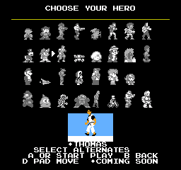
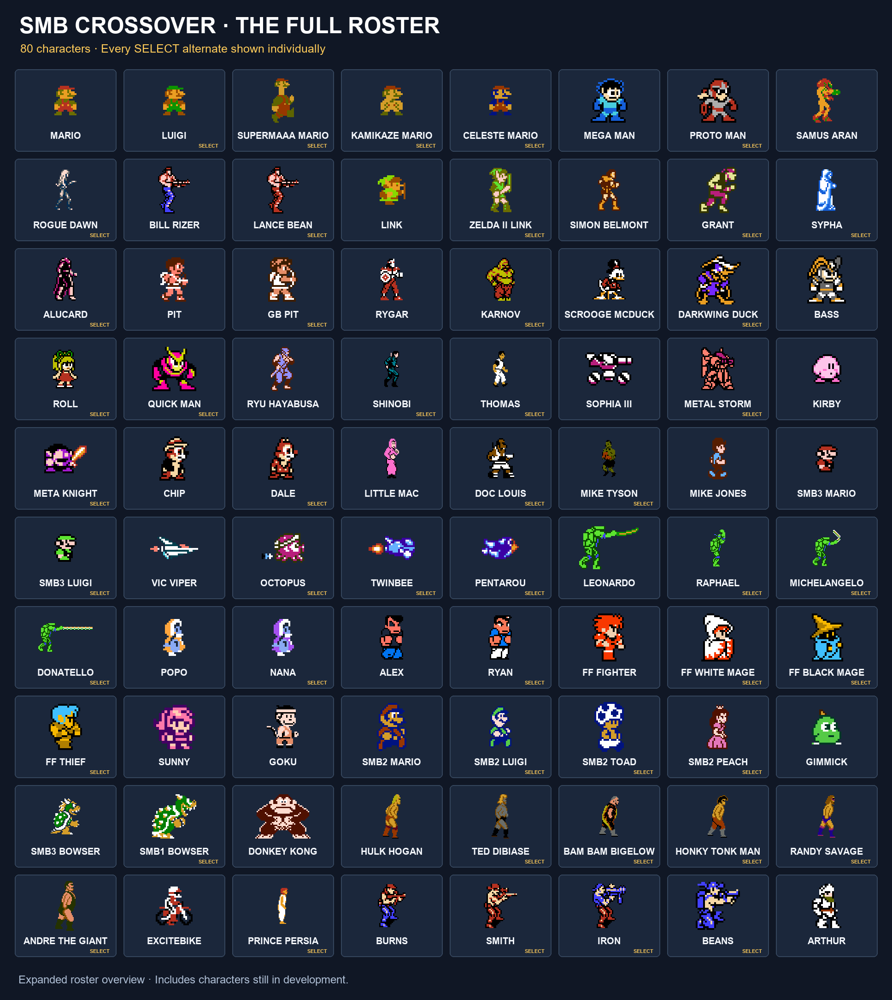

# SMB Crossover for NES

**One Mushroom Kingdom. A whole NES library of heroes.**

A native NES adaptation of [Super Mario Bros. Crossover](https://www.smbgames.be/smb-crossover.php), built on [SMB1Base](https://github.com/smbstudio/smb1base). Play SMB's levels with character-specific movement, weapons, upgrades, music and health systems.

[Player's guide](<Player Guide/SMB-Crossover-Players-Guide-NU.pdf>) · [Full roster image](docs/images/SMB-Crossover-Full-Roster.png) · [Build from source](#build-from-source) · [Report a bug](https://github.com/kandowontu2/SMB-Crossover/issues)

> **In development:** the latest expanded MMC5 checkpoint has **74 playable identities**, including alternates, across a **32-slot, four-row menu**. Another **12 individual identities** are coming soon. The prepared source build currently contains 37 identities; see the build table below.

<p align="center">
  
</p>

*Actual emulator capture from the October 30 64-character WIP.*

## What's in the game?

- **Distinct characters.** Busters, swords, arrows, Morph Ball bombs, pogo attacks, copy abilities, a Diskarmor and more.
- **Character-specific progression.** Health, ammo, EXP, spells, weapon inventories and upgrades vary by character.
- **Easy and Hard modes.** Easy enables ordinary stomping for ground characters; Hard uses character-specific contact rules and the migrated Crossover 2.02 equipment systems.
- **More than a reskin.** Zelda II Link has an upgrade/spell menu, SMB3 Mario has multiple forms and a P meter, and the Gradius/Parodius ships have graphical powerup bars.
- **Options for testing and play.** Player outlines, level selection, invincibility, mid-air jumps, screen wrapping, a frozen timer and full power.
- **An audio browser.** Test character-labelled music and sound effects in the expanded MMC5 build.

The title opens a separate character-select screen. Use the D-pad to highlight a slot and **Select** to cycle its alternates.

## Current roster

This table describes the **74-playable development checkpoint**, not the older prepared build. A character visible in the menu is not necessarily playable: names marked with a star are **COMING SOON**.

| Slot | Playable now | Coming soon |
| --- | --- | --- |
| Mario | Mario / Luigi / Toad / Peach / Super Maaa / Kamikaze Mario / Celeste Mario | — |
| Mega Man | Mega Man / Proto Man | — |
| Metroid | Samus / Rogue Dawn | — |
| Contra | Bill Rizer / Lance Bean | — |
| Zelda | Link / Zelda II Link | — |
| Castlevania | Simon / Grant / Sypha / Alucard | — |
| Kid Icarus | Pit / GB Pit | — |
| Rygar | Rygar | Karnov |
| DuckTales | Scrooge / Darkwing Duck | — |
| Bass | Bass / Roll / Quick Man | — |
| Ninja Gaiden | Ryu Hayabusa | Shinobi / Thomas |
| Blaster Master | Sophia III | Metal Storm |
| Kirby | Kirby / Meta Knight | — |
| Rescue Rangers | Chip / Dale | — |
| Punch-Out!! | Little Mac / Doc Louis / Mike Tyson | — |
| StarTropics | Mike Jones | — |
| SMB3 | SMB3 Mario / Luigi / Toad / Peach | — |
| Gradius / Parodius | Vic Viper / Octopus / TwinBee / Pentarou | — |
| TMNT | Leonardo / Raphael / Michelangelo / Donatello | — |
| Ice Climber | Popo / Nana | — |
| River City Ransom | Alex / Ryan | — |
| Final Fantasy | Fighter / White Mage / Black Mage / Thief | — |
| Super Sunny World | Sunny | — |
| Battletoads | Rash / Zitz | — |
| SMB2 | Mario / Luigi / Toad / Peach | — |
| Gimmick! | Gimmick | — |
| Bowser | SMB3 Bowser / SMB1 Bowser | — |
| Donkey Kong | Donkey Kong | — |
| WWF WrestleMania | — | Hulk Hogan / Ted DiBiase / Bam Bam Bigelow / Honky Tonk Man / Randy Savage / Andre the Giant |
| Excitebike | — | Excitebike / Prince of Persia |
| Contra Force | Burns / Smith / Iron / Beans | — |
| Ghosts 'n Goblins / Dragon Power | Arthur / Goku | — |

<details>
<summary><strong>Earlier 80-character portrait sheet</strong></summary>



The image includes unfinished characters and predates the two new SMB1 alternates and Goku's move to Arthur's Select alternates. Use the table above for availability.

</details>

The four SMB2 characters, four Final Fantasy classes and both SMB1 and SMB3 Toad/Peach are enabled, with bounded emulator checks recorded for their respective build hashes. Goku is an Arthur Select alternate. Further Mario alternates and Getsu Fuma for Simon remain in development and are not included in the current 86-individual count.

On **Battletoads**, Select cycles **Rash → Zitz**. On **Contra Force**, it cycles **Burns → Smith → Iron → Beans**. These six use recovered original-game movement, graphics and attacks. The latest checkpoint fixes their lives portraits and colors, Contra Force's blocked jump input, and its landing/contact synchronization. All six pass bounded native checks on the release hash; full levels, complete special moves, upgrades and dedicated audio remain unfinished. Battletoads and Contra Force are noticeably slow. See the [74-character WIP receipt](docs/qa/functional-roster-ready74-bt-cf-2026-10-31.json).

On the SMB3 slot, **Select cycles Mario → Luigi → Toad → Peach**. The new Toad/Peach use graphics and controller routines recovered from Infidelity's SMB3+ hack, including Toad's big-form kick and Peach's hover. Names and lives portraits are updated. Donor ground pound, custom stomp delay, some special art consumers and Toad's kick sound remain unfinished. See the [68-character WIP receipt](docs/qa/functional-roster-ready68-smb3plus-2026-10-31.json).

Both Bowser versions are enabled in the October 31 WIP. They have source-derived movement, fire breath and health, with corrected injury handling and lives portraits. SMB1 Bowser uses a stronger playable jump to clear SMB's pipes. Both pass bounded Mesen checks; lag, extended attacks and original SMB3 audio still need work. See the [66-character verification receipt](docs/qa/functional-roster-ready66-bowser-2026-10-31.json). The full roster's level and powerup audit is still in progress.

## Choose a build

| Target | Roster | Cartridge layout | Status |
| --- | --- | --- | --- |
| Expanded MMC5 checkpoint | 74 playable / 86 individual identities | 1 MiB PRG + 1 MiB CHR | Newest development work; frozen source and recipes are in the checkpoint archives. |
| Prepared expanded MMC5 | 37 identities | 1 MiB PRG + 1 MiB CHR | Reproduced by the commands below. |
| Standard MMC3 / MMC5 | 14 identities in 12 slots | 512 KiB PRG + 256 KiB CHR | Smaller original roster. |
| Oversized MMC3 | Expanded roster | 2 MiB PRG + 256 KiB CHR RAM | Experimental; feature parity and physical cartridge compatibility remain unverified. |

**MMC5 is the main target for the full roster.** Mesen 2 is used for development and testing. The oversized MMC3 implementation needs eight-bit PRG banking and 256 KiB CHR RAM; Parodius currently uses a text powerup bar on that target.

Generated ROMs are excluded from this repository. The newer checkpoint source has not yet been folded into the prepared builder, so the commands below do **not** produce the 74-character checkpoint.

## Build from source

Requires **Python 3.10+** and **cc65**. Windows compiler tools are included. On other systems, install cc65 and put `cl65` on your PATH.

From the repository root:

```sh
python tools/prepare_guest_audio.py
python tools/build_mmc5_expanded.py
```

Open `build/smb-crossover-mmc5-expanded.nes` in an emulator with MMC5 support. A companion `.build.json` receipt records the ROM's SHA-256 hash.

The prepared build uses repository assets and does not require downloading original ROMs or research archives. Asset regeneration and research tools have additional dependencies; see the [architecture and provenance notes](docs/architecture.md).

<details>
<summary>Compiler overrides and other targets</summary>

Use a different compiler:

```sh
python tools/build_mmc5_expanded.py --compiler /path/to/cl65
```

Build the smaller standard targets after audio preparation:

```sh
python tools/build_mmc5_expanded.py --flag-off mmc3 --output build/smb-crossover-mmc3.nes
python tools/build_mmc5_expanded.py --flag-off mmc5 --output build/smb-crossover-mmc5.nes
```

The experimental oversized builder is `tools/build_mmc3_oversized.py`. It requires a freshly built expanded MMC5 ROM as its graphics reference.

</details>

## Controls

| Action | Controls |
| --- | --- |
| Main menu | Up/Down selects START or OPTIONS; A or Start confirms. |
| Character selection | D-pad moves; Select cycles alternates; A or Start begins; B returns. |
| Movement and aiming | D-pad. |
| Jump / attack | Usually A to jump and B to attack or run; character-specific exceptions apply. |
| Pause | Start. |
| Mega Man / Bass weapons | Select cycles acquired weapons, including the normal weapon. |
| Supported weapon inventories | Paused Left/Right chooses equipment; paused Select returns to the primary weapon. |
| Gradius / Parodius | A fires; B purchases the highlighted upgrade. |
| Audio test | Up/Down chooses a character; Left/Right chooses a cue; Select switches music/SFX; A plays; Start stops; B returns. |

See the [illustrated player's guide](<Player Guide/SMB-Crossover-Players-Guide-NU.pdf>) for individual moves and tips. Zelda II Link has his own paused spell/stat interface. The guide is updated separately and may lag behind the ROM.

### Easy, Hard and options

**Easy is the default.** Ground characters can ordinarily stomp enemies, and the original guest roster uses the earlier Crossover power progression.

**Hard** uses character-specific enemy contact rules and the migrated Crossover 2.02 equipment systems. Many guests must attack instead of landing on enemies. Mario, Luigi and the SMB3 quartet retain ordinary stomping in both modes; ships and special body attacks follow their own rules.

Options include:

- **Player outlines:** off by default. Extra black sprites improve some characters' contrast but can increase flicker.
- **Mode:** Easy or Hard.
- **Cheats:** invincibility, starting level (1-1 through 8-4), mid-air jumps, screen wrap, freeze timer and full power.
- **Audio test:** character-labelled music and SFX. Some cues share an underlying track.

The chosen starting level applies when confirming a character. Invincibility does not prevent pit or time-out deaths. Full power restores compatible health, ammo and upgrades. Settings last until reset; B returns from submenus.

## Development status

The latest development checkpoint is `a12661c1` (October 31), with **74 playable identities**. It enables Rash, Zitz and the four Contra Force characters, following source recovery and fixes found in real emulator runs. Root reviewed 24 full-frame screenshots and checked selection, lives screens, movement, jumping, landing, attacks and interrupt restoration on this exact cartridge. Each run covers 360–362 physical gameplay frames. These are early functional unlocks with substantial lag; they do not establish full level or powerup completion. See the [current build receipt](docs/qa/functional-roster-ready74-bt-cf-2026-10-31.json) and [native verification](docs/qa/checkpoints/2026-10-31/ready74-bt-cf-native-v1/README.md).

The earlier `01a40d40` checkpoint enabled SMB3 Toad and Peach. Their source-derived graphics and controller routines, including Peach's 80-update hover, remain included. Their earlier native checks and remaining donor ground-pound, stomp-delay and audio work are recorded in the [68-character receipt](docs/qa/functional-roster-ready68-smb3plus-2026-10-31.json).

The earlier `f56e55cd` checkpoint corrected SMB1 Peach's normal colors after `98048319` selected an enemy palette. That correction is retained. SMB1 Toad/Peach use Benj Edwards' supplied sprites and recovered float behavior; their HUDs still say MARIO, and special float contacts and fire/star/area palette progression remain unfinished. See the [palette correction checks](docs/qa/checkpoints/2026-10-30/peach-palette-correction-native/README.md).

The earlier `dfdb194a` checkpoint enabled the SMB2 quartet and four Final Fantasy classes, moved Goku behind Arthur, and repaired SMB2 backdrop/palette handling and both families' lives screens. Those changes and the Donkey Kong icon, facing and fourth-row menu fixes remain included. Its [eight native checks](docs/qa/checkpoints/2026-10-30/ready62-native-unlocks/README.md) apply to that earlier hash.

**Known FF issues:** an earlier full-level Fighter attempt exposed a render-timing glitch that remains unfixed. Required black outlines and White Mage's reported damage problem are also pending. The eight new bounded checks do not establish complete level, combat or powerup coverage; this checkpoint prioritizes playable unlocks.

Work still in progress includes lag and sprite flicker, remaining character implementations, dedicated audio, some animations/HUDs, broader collision checks and complete campaign/powerup coverage. “Playable” means selectable in the development checkpoint; it is not a claim that every character or level has passed the full audit. Adaptations for SMB's levels and NES controls also mean the project does not promise exact original-game or Crossover 2.02 behavior for every character.

For detailed records:

- [Earlier checkpoint history](docs/development-checkpoints.md)
- [Architecture and provenance](docs/architecture.md)
- [Source comparison notes](docs/reference/parity.md)
- [Checkpoint source archives and QA](docs/qa/checkpoints/2026-10-30/)
- [Recorded roster playthroughs](docs/qa/current-roster-progress-2026-10-27.json)

QA results apply to their recorded ROM hashes. A passing older test does not certify a later build.

## Report a bug

[Open an issue](https://github.com/kandowontu2/SMB-Crossover/issues) with:

- Character and alternate, Easy/Hard mode, level and mapper target.
- Emulator/version or the hardware and flash cartridge used.
- Steps to reproduce, expected behavior and what happened.
- A screenshot or short clip, and the ROM hash from its build receipt if available.

## Repository map

| Folder | Contents |
| --- | --- |
| `src/`, `inc/` | Game code and assembly includes. |
| `chr/`, `audio/` | Prepared graphics and audio. |
| `tools/`, `tests/` | Builders, conversion tools and emulator checks. |
| `docs/` | Architecture, research, provenance and checkpoint QA. |
| `Player Guide/` | Illustrated guide and editable source material. |

## Credits

- **[Super Mario Bros. Crossover](https://www.smbgames.be/smb-crossover.php):** the browser-game concept and reference.
- **[SMB1Base](https://github.com/smbstudio/smb1base):** the foundation for this port. Its original information is preserved in [the upstream README](docs/SMB1BASE.md).

Additional ROM-hack sources, including requested alternates still in development:

| Source | Credit |
| --- | --- |
| [Super Duper Mario Bros. 4P](https://github.com/benj-edwards/NESCoopMods), supplied v44 build | Benj Edwards |
| Super Mario Bros. 3+ | infidelity |
| Super Maaaaaaaaaaaaaaaa | jroweboy |
| Celeste Mario's Zap & Dash Deluxe | w7n, studsx and edengt |
| [Metroid: Rogue Dawn](https://metroidconstruction.com/hack.php?id=441) | Grimlock (lead, graphics and level design), snarfblam (programming and editor), Optomon (sound engine, effects and music), plus its original README's contributors |

This is an unofficial fan project. Original games, characters, artwork and music belong to their respective creators. Source and asset provenance are documented in the research and architecture notes.
